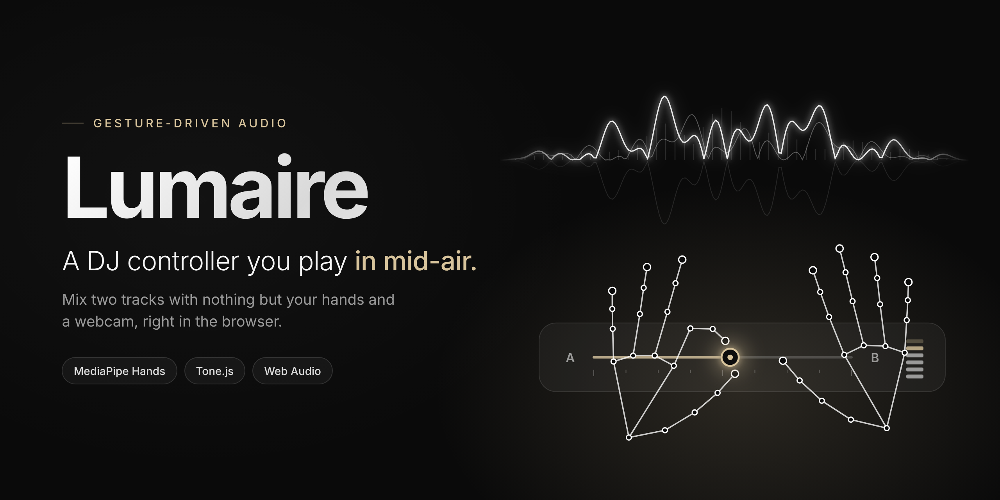

<div align="center">



# Lumaire

### A DJ controller you play in mid-air

Mix two tracks with nothing but your hands and a webcam, right in the browser.

**[Try the live demo](https://sehgalbhavya.github.io/Lumaire/)** · **[Watch the video](https://www.youtube.com/watch?v=3lUEl5AKHR8)**

[](https://developers.google.com/mediapipe)
[](https://tonejs.github.io)
[](https://vite.dev)
[](https://developer.mozilla.org/docs/Web/JavaScript)

</div>

---

## The idea

A DJ mixer is a wall of knobs and faders. Every one of them is something your hands already know how to do: pinch, slide, raise, clench.

Lumaire takes the hardware away and keeps the hands. A webcam tracks both of your hands in real time, and each gesture maps onto a control on a two-deck mixer. You pinch to start a track, slide to crossfade, and clap to bring the two songs onto the same beat. There is nothing to install and nothing to plug in.

The question behind it is simple: **can gestures in mid-air feel as direct as touching a real mixer?**

---

## Demo

<div align="center">

[](https://www.youtube.com/watch?v=3lUEl5AKHR8)

</div>

To try it yourself, open the **[live demo](https://sehgalbhavya.github.io/Lumaire/)** in Chrome or Edge:

1. Allow camera access when the browser asks.
2. Click anywhere on the page once to switch on audio (browsers require this).
3. Load a song into **Track A** and another into **Track B**.
4. Raise both hands so the camera can see them, and start mixing.

---

## How you play it

Your left hand runs **Deck A** and the crossfader. Your right hand runs **Deck B** and the master volume. A quick pinch is a tap; a pinch you hold and move is a drag.

| | Gesture | What it does |
|---|---|---|
| **Left hand** | Quick pinch | Play or pause Track A |
| | Pinch and slide left or right | Move the crossfader between A and B |
| | Make a fist and move up or down | Treble up or down |
| **Right hand** | Quick pinch | Play or pause Track B |
| | Pinch and move up or down | Master volume |
| | Make a fist and move up or down | Bass up or down |
| **Both hands** | Clap | Beat-match: Track B is sped up or slowed down to Track A's tempo and lined up on the beat |

### No camera? Use the keyboard or mouse

| Input | Action |
|---|---|
| `P` | Play or pause both tracks |
| Hold `A` + `Space` | Play or pause Track A |
| Hold `B` + `Space` | Play or pause Track B |
| `↑` / `↓` | Master volume |
| `←` / `→` | Crossfader |
| Hold `T` + `↑` / `↓` | Treble |
| Hold `B` + `↑` / `↓` | Bass |
| `C` | Clap cue (visual feedback only) |
| Click Master, Bass or Treble | Nudge that value up (hold `Shift` to nudge it down) |
| Click the Crossfader display | Jump the crossfader to that spot |

---

## How it works

Lumaire is split into four small engines that never call each other directly. They only read from and write to one shared state store, so the hand tracking, the sound and the visuals can each run at their own pace.

```
 Webcam ──► MediaPipe Hands (21 landmarks per hand)
                     │
                     ▼
            ┌─────────────────┐
            │ Gesture engine  │  pinch, fist and clap detection,
            │                 │  tap vs. drag, mirror correction
            └────────┬────────┘
                     │ writes
                     ▼
            ┌─────────────────┐
            │   State store   │  volume · crossfader · bass · treble
            │                 │  deck A/B playing · last clap
            └───┬─────────┬───┘
          reads │         │ reads
                ▼         ▼
   ┌────────────────┐  ┌──────────────────┐
   │  Audio engine  │  │  Visual engine   │
   │  Tone.js       │  │  Canvas 2D       │
   │  two decks,    │  │  hand skeletons, │
   │  EQ, fader,    │  │  mixer HUD,      │
   │  beat-matching │  │  live spectrum   │
   └────────────────┘  └──────────────────┘
```

A few details worth knowing:

- **Sound never waits for graphics.** Playback is scheduled on the Web Audio clock through Tone.js, so the music stays steady even if the video frame rate drops.
- **Beat-matching on a clap.** When a track loads, its tempo is estimated from its rhythm (an autocorrelation over 60 to 180 BPM). A clap smoothly adjusts Track B's speed to match Track A, within ±10% so it doesn't sound warped, then shifts it so the beats line up.
- **EQ like a real mixer.** Bass and treble are shelf filters (below 200 Hz and above 3 kHz) with ±12 dB of range.
- **Gestures that don't misfire.** A fist always wins over a pinch, a pinch has to move before it counts as a drag, and a clap must be a fast approach with a short cooldown, so resting your hands together doesn't trigger it.

---

## Run it locally

You need [Node.js](https://nodejs.org) 20 or newer and a webcam (optional, thanks to the keyboard controls).

```bash
git clone https://github.com/sehgalbhavya/Lumaire.git
cd Lumaire
npm install
npm run dev
```

Then open the address Vite prints (it ends in `/Lumaire/`).

To build for production, run `npm run build`. Every push to `main` is built and published to GitHub Pages automatically.

---

## Project structure

```
Lumaire/
├── index.html            App shell and mixer panel
├── public/
│   └── banner.png        README banner
├── src/
│   ├── main.js           Wiring, track loading, keyboard and mouse controls
│   ├── gestureEngine.js  Turns hand landmarks into pinch, fist and clap gestures
│   ├── audioEngine.js    Two decks, EQ, crossfader, tempo detection, beat-matching
│   ├── visualEngine.js   Draws the video, hand skeletons, mixer HUD and spectrum
│   ├── stateStore.js     Shared state with subscribe and update
│   └── style.css         Interface styling
└── .github/workflows/
    └── deploy-pages.yml  Builds and deploys to GitHub Pages
```

---

<div align="center">

<sub>Lumaire began as a project in a multimodal interaction course at KTH Royal Institute of Technology.</sub>

</div>
